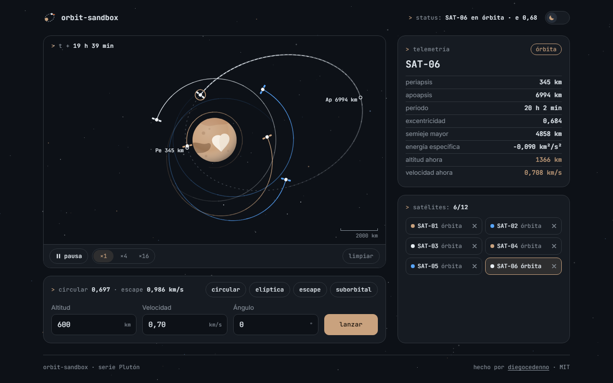

# orbit-sandbox

> An orbit sandbox: drag to launch satellites around Pluto and watch the real orbit that comes out of it — an ellipse, a fall or an escape.
>
> Un sandbox de órbitas: arrastra para lanzar satélites alrededor de Plutón y mira la órbita real que resulta: una elipse, una caída o un escape.

**[Live demo · Demo en vivo →](https://diegocedenno.github.io/orbit-sandbox/)**

[](https://diegocedenno.github.io/orbit-sandbox/)

**[English](#english)** · **[Español](#español)**

---

## English

### What it does

- Press anywhere in space to set the starting point, drag to set the velocity vector and release. While you drag, the aim line shows the speed in km/s and the predicted trajectory is drawn dotted.
- Every launch is classified on the spot from its state vector: **orbit** (bound, periapsis above the surface), **impact** (periapsis below the surface: the satellite falls and goes out with a small flash) or **escape** (it leaves the frame and is retired).
- The telemetry console shows the selected satellite's periapsis and apoapsis altitudes, period, eccentricity, semi-major axis and specific energy, plus its live altitude and speed. Both apsides are marked on its orbit.
- Everything the pointer does is also there for the keyboard: a small form (altitude, speed, angle) and four presets — circular, elliptical, escape and suborbital — computed for the altitude you typed.
- Up to twelve satellites at once, each with a fading trail, in a list where you can select or remove them. Pause, run at ×1, ×4 or ×16, or clear the sky.
- Pluto is drawn to scale (radius 1188.3 km, μ = 869.6 km³/s²) and all readouts are in real units. Satellites still in orbit and the simulation speed survive a reload (`localStorage`).
- A switch in the header flips between dark and light mode: the same sky redrawn as a star chart on paper. The choice is remembered and shared across the Plutón series.

### What makes it technically interesting

- **A symplectic integrator, not Euler.** The two-body problem is integrated with leapfrog (velocity Verlet, kick–drift–kick) at a fixed 5 s step. Energy oscillates within bounds instead of drifting: after 100 circular orbits the radius is still 1788.300 km and the energy has never strayed more than 10⁻⁹ %; a 0.9-eccentricity orbit stays under 0.003 %.
- **Physics independent of the frame rate.** Real time feeds an accumulator that is consumed in fixed sub-steps, so 30 fps and 144 fps produce the same orbit. At ×16 that is roughly 30 sub-steps per satellite per frame.
- **Analytic classification.** Specific energy ε = v²/2 − μ/r, the eccentricity vector and the angular momentum give the conic before a single step is simulated. The dotted preview, the full orbit of the selected satellite and the apsis markers come from that conic (an exact SVG elliptical arc when it is bound), not from a second simulation.
- **Time-reversible restore.** Leapfrog retraces its own path with a negative step, so when satellites are restored from `localStorage` their trails are rebuilt by integrating backwards from the saved state.
- **One loop, transforms only.** A single `requestAnimationFrame` writes one `transform` per satellite per frame. Trails live on a background canvas, stored in kilometres and flight seconds, so their length follows the orbit and not the frame rate, and they are redrawn in a dozen opacity steps instead of one stroke per segment.
- **Reduced motion is a first-class path.** With `prefers-reduced-motion` the loop never starts: each launch draws its complete analytic orbit, the satellite stays at its starting point and changes are opacity fades.
- **Pure logic, testable from Node.** `js/physics.js` has no DOM:

  ```bash
  node -e "require('./js/physics.js'); const P = OrbitSandbox.physics; const s = P.fromLaunch(600, P.circularSpeed(P.RADIUS + 600), 0, 0); P.advance(s, 322263, P.STEP); console.log(Math.hypot(s.x, s.y))"
  ```

  prints `1788.3` after 100 orbits (the period matches 2π√(a³/μ) = 16 113 s).
- **Zero dependencies, zero build.** Plain HTML, CSS and JavaScript. Fonts are bundled; nothing is requested from the network.

### Controls

| Input | Action |
| --- | --- |
| Press, drag and release in space | Launch: start point, then velocity vector (about 1 km/s per 110 px) |
| Tap a satellite, or its row in the list | Select it and show its orbital elements |
| `Tab` to the form, `Enter` | Launch with altitude, speed and angle above the local horizon |
| `↑` `↓` in a field | Step the value |
| `Esc` while dragging | Cancel the launch |

### Run it

Double-click `index.html`. That is all — there is no build step and no server.
It also works as-is on GitHub Pages.

### License

[MIT](LICENSE) © Diego Cedeño. Inter and JetBrains Mono are bundled under the [SIL Open Font License](assets/fonts/).

---

## Español

### Qué hace

- Presiona en cualquier punto del espacio para fijar la posición inicial, arrastra para fijar el vector de velocidad y suelta. Mientras arrastras, la línea de puntería muestra la magnitud en km/s y la trayectoria prevista se dibuja punteada.
- Cada lanzamiento se clasifica al momento a partir de su vector de estado: **órbita** (ligada y con el periapsis sobre la superficie), **impacto** (periapsis bajo la superficie: el satélite cae y desaparece con un pequeño destello) o **escape** (sale del encuadre y se retira).
- La consola de telemetría muestra, del satélite elegido, las altitudes de periapsis y apoapsis, el periodo, la excentricidad, el semieje mayor y la energía específica, además de su altitud y velocidad en vivo. Los dos ápsides quedan marcados sobre su órbita.
- Todo lo que hace el puntero está también para el teclado: un pequeño formulario (altitud, velocidad, ángulo) y cuatro lanzamientos predefinidos —circular, elíptica, escape y suborbital— calculados para la altitud escrita.
- Hasta doce satélites a la vez, cada uno con su estela que se desvanece, en una lista donde se seleccionan o se quitan. Pausa, velocidad ×1, ×4 o ×16, y limpiar.
- Plutón está dibujado a escala (radio 1188,3 km, μ = 869,6 km³/s²) y todas las lecturas van en unidades reales. Los satélites que siguen en órbita y la velocidad de simulación sobreviven a una recarga (`localStorage`).
- Un interruptor en la cabecera alterna entre modo oscuro y claro: el mismo cielo redibujado como carta estelar sobre papel. La elección se recuerda y se comparte entre los proyectos de la serie Plutón.

### Qué lo hace interesante técnicamente

- **Un integrador simpléctico, no Euler.** El problema de dos cuerpos se integra con leapfrog (velocity Verlet, impulso–deriva–impulso) a paso fijo de 5 s. La energía oscila acotada en vez de derivar: tras 100 órbitas circulares el radio sigue en 1788,300 km y la energía no se ha apartado más de un 10⁻⁹ %; una órbita de excentricidad 0,9 se queda por debajo del 0,003 %.
- **Física independiente de los fps.** El tiempo real alimenta un acumulador que se consume en subpasos fijos, así que a 30 y a 144 fps sale la misma órbita. A ×16 son unos 30 subpasos por satélite y frame.
- **Clasificación analítica.** La energía específica ε = v²/2 − μ/r, el vector de excentricidad y el momento angular dan la cónica antes de simular un solo paso. La trayectoria punteada, la órbita completa del satélite elegido y las marcas de los ápsides salen de esa cónica (un arco elíptico SVG exacto cuando está ligada), no de una segunda simulación.
- **Restauración reversible en el tiempo.** El leapfrog desanda su propio camino con un paso negativo: al restaurar los satélites desde `localStorage`, sus estelas se reconstruyen integrando hacia atrás desde el estado guardado.
- **Un solo bucle, solo transforms.** Un único `requestAnimationFrame` escribe un `transform` por satélite y frame. Las estelas viven en un canvas de fondo, guardadas en kilómetros y segundos de vuelo, de modo que su longitud sigue a la órbita y no a los fps, y se repintan en una docena de escalones de opacidad en lugar de un trazo por segmento.
- **El movimiento reducido es un camino de primera clase.** Con `prefers-reduced-motion` el bucle no arranca: cada lanzamiento dibuja su órbita analítica completa, el satélite queda quieto en su posición inicial y los cambios son fundidos de opacidad.
- **Lógica pura, comprobable desde Node.** `js/physics.js` no toca el DOM:

  ```bash
  node -e "require('./js/physics.js'); const P = OrbitSandbox.physics; const s = P.fromLaunch(600, P.circularSpeed(P.RADIUS + 600), 0, 0); P.advance(s, 322263, P.STEP); console.log(Math.hypot(s.x, s.y))"
  ```

  imprime `1788.3` tras 100 órbitas (el periodo coincide con 2π√(a³/μ) = 16 113 s).
- **Cero dependencias, cero build.** HTML, CSS y JavaScript sin más. Las fuentes van incluidas; no se pide nada a la red.

### Controles

| Entrada | Acción |
| --- | --- |
| Presionar, arrastrar y soltar en el espacio | Lanzar: punto de salida y luego vector de velocidad (cerca de 1 km/s cada 110 px) |
| Tocar un satélite o su fila en la lista | Elegirlo y ver sus elementos orbitales |
| `Tab` hasta el formulario, `Enter` | Lanzar con altitud, velocidad y ángulo sobre el horizonte local |
| `↑` `↓` en un campo | Subir o bajar el valor |
| `Esc` mientras arrastras | Cancelar el lanzamiento |

### Cómo correrlo

Doble clic en `index.html`. Nada más: no hay build ni servidor.
También funciona tal cual en GitHub Pages.

### Licencia

[MIT](LICENSE) © Diego Cedeño. Inter y JetBrains Mono se incluyen bajo la [SIL Open Font License](assets/fonts/).
